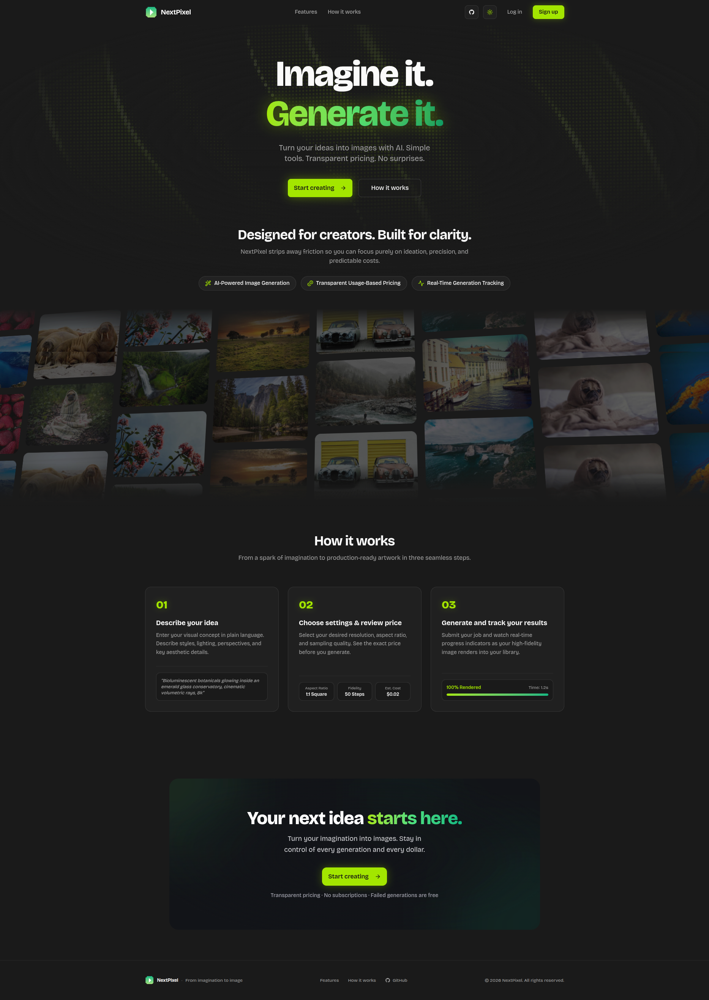
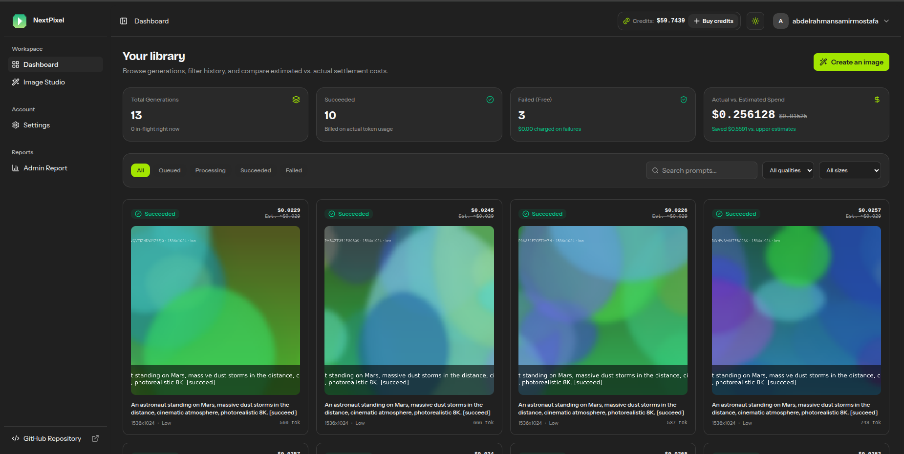
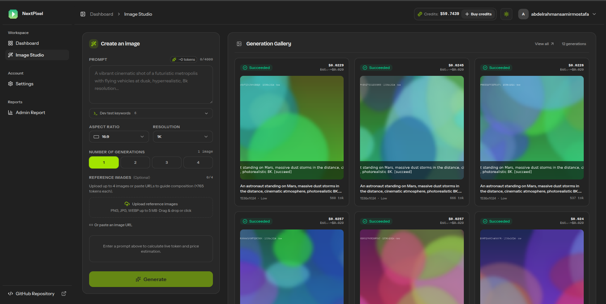
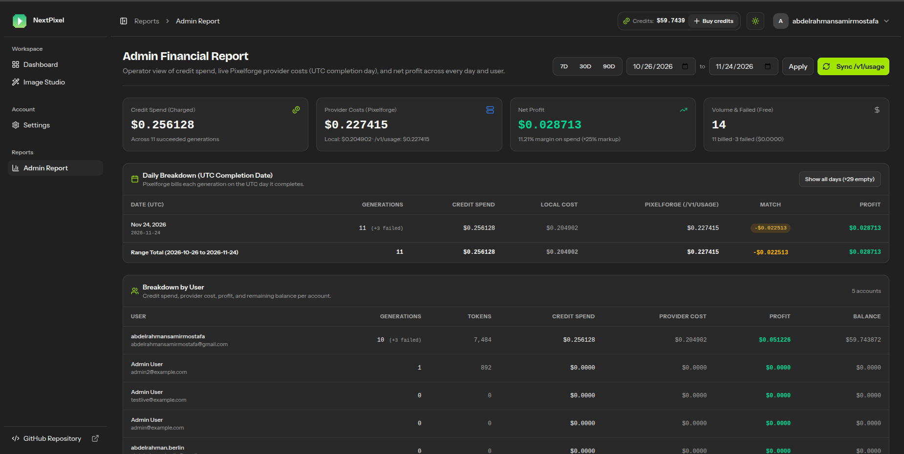

# NextPixel

An AI image generation platform integrating the **Pixelforge API**, with progress tracking and usage-based pricing, built with Laravel and Vue.js.

- [Info](#info)
- [Preview](#preview)
- [Technology Stack](#technology-stack)
- [Getting Started](#getting-started)
    - [1. Installation](#1-installation)
    - [2. Environment Configuration](#2-environment-configuration)
    - [3. Development Services](#3-development-services)
    - [4. Webhook Tunneling](#4-webhook-tunneling-local-development)
- [Quality Assurance & Verification](#quality-assurance--verification)
- [Documentation Index](#documentation-index)

---

## Info

- **PromptEdit Email:** `abdelrahmansamirmostafa@gmail.com`
- **Live Preview:** [https://next-pixel-production-lfhpfm.laravel.cloud/](https://next-pixel-production-lfhpfm.laravel.cloud/)

---

## Preview

### Landing Page



### Dashboard & Library



### Image Studio & Real-Time Cost Estimator



### Admin Financial Report (Operator Reconciliation)



---

## Technology Stack

| Layer              | Technologies                                                                     |
| :----------------- | :------------------------------------------------------------------------------- |
| **Backend**        | Laravel 13, PHP 8.5, PostgreSQL                                                  |
| **Frontend**       | Vue 3 , Inertia.js 3, Tailwind CSS 4                                             |
| **Precision Math** | PHP `bcmath` extension (`DECIMAL(18, 9)`)                                        |
| **Testing**        | Pest PHP, PHPUnit, HTTP Client Mocking                                           |

## Getting Started

### 1. Installation

```bash
# Clone the repository
git clone https://github.com/iSemary/next-pixel.git
cd next-pixel

# Install dependencies
composer install
npm install

# Setup environment
cp .env.example .env
php artisan key:generate

# Run database migrations
php artisan migrate

# Build frontend assets
npm run build
```

### 2. Environment Configuration

Add your Pixelforge credentials to `.env`:

```ini
PIXELFORGE_BASE_URL=https://pixelforge.promptedit.dev
PIXELFORGE_API_KEY=pf_live_your_api_key_here
PIXELFORGE_WEBHOOK_SECRET=pf_whsec_your_secret_here
```

### 3. Development Services

Run all services concurrently:

```bash
composer run dev
```

Or run them individually:

```bash
# Laravel development server
php artisan serve

# Vite HMR dev server
npm run dev

# Queue worker (required for asynchronous generations)
php artisan queue:work
```

### 4. Webhook Tunneling (Local Development)

Pixelforge needs a public URL to deliver webhooks. Start a tunnel (e.g. Expose, ngrok, or Cloudflare Tunnel):

```bash
ngrok http 80 --host-header=next-pixel.test
```

Register the public URL in your [Pixelforge Dashboard](https://pixelforge.promptedit.dev/):

```
https://<your-tunnel-subdomain>.ngrok-free.app/webhooks/pixelforge
```

---

## Quality Assurance & Verification

Run the full automated test suite and static analysis:

```bash
# Run all Pest feature & unit tests (146 tests, 947 assertions)
php artisan test

# Run TypeScript typecheck
npm run types:check

# Run Biome code check & formatting
npm run check

# Run Laravel Pint code style check
./vendor/bin/pint --test
```

---

## Documentation Index

Comprehensive technical documentation is maintained in the [`docs/`](docs/README.md) directory:

- [Architecture & Standards](docs/architecture/README.md)
- [Authentication](docs/authentication/README.md)
- [Pixelforge API Client](docs/pixelforge-api/README.md)
- [Database Schema & Models](docs/database-schema/README.md)
- [Pricing Estimation Engine](docs/pricing-engine/README.md)
- [Frontend & UI Design System](docs/frontend/README.md)
- [Postman API Collection](docs/postman/README.md)
- [Testing & Quality Assurance](docs/testing/README.md)
