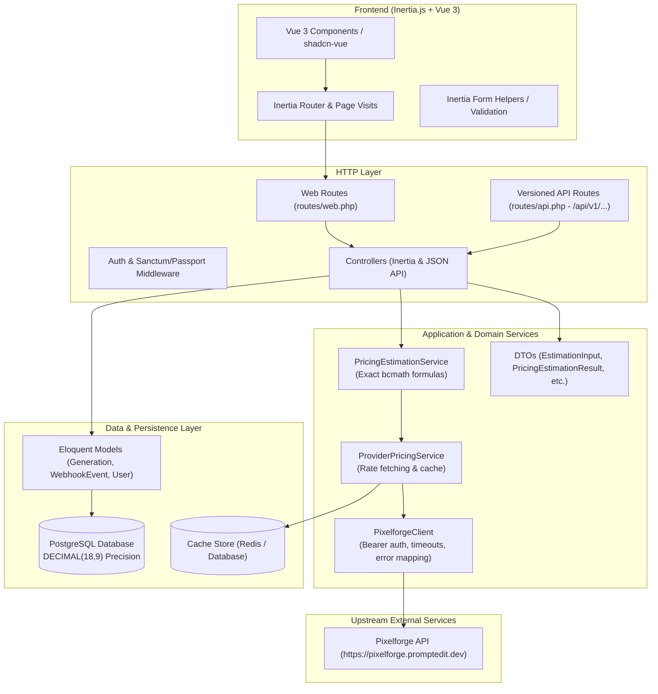

# System Architecture & Design Standards

NextPixel is designed around clean architecture principles, strict domain boundary separation, and defensive financial computing. This document describes the foundational patterns and standards followed across the codebase.

---

## High-Level Architecture



---

## Architectural Principles

### 1. Separation of Concerns & Service Layer

- **Controllers** remain thin: they handle request validation, delegate to dedicated domain services or actions, and return either Inertia page responses or JSON responses.
- **Domain Services** encapsulate business logic (e.g. pricing calculations, upstream communication, webhook processing) behind interfaces bound in [`RepositoryServiceProvider`](file:///home/abdelrahman/me/next-pixel/app/Providers/RepositoryServiceProvider.php).
- **Data Transfer Objects (DTOs)** isolate service inputs and outputs, ensuring data integrity before persistence or external presentation.

### 2. Zero Floating-Point Arithmetic for Monetary Values

Financial calculations involving tokens, platform markup, provider rates, or billing must **never** use native PHP floating-point numbers (`float`).

- All financial numbers are stored and processed as numeric strings.
- Arithmetic is executed using PHP's native `bcmath` extension with an explicit scale of 9 (`scale = 9`).
- Database columns use `DECIMAL(18, 9)` and Eloquent models cast them using `decimal:9` via Laravel's `asDecimal()` casting (`brick/math` BigDecimal).

### 3. Interface-Driven Dependency Injection

All major service boundaries are defined by interfaces:

- `PixelforgeClientInterface` $\rightarrow$ `PixelforgeClient`
- `ProviderPricingServiceInterface` $\rightarrow$ `ProviderPricingService`
- `PricingEstimationServiceInterface` $\rightarrow$ `PricingEstimationService`

Container registrations are centrally managed in [`app/Providers/RepositoryServiceProvider.php`](file:///home/abdelrahman/me/next-pixel/app/Providers/RepositoryServiceProvider.php). This pattern ensures that any service can be cleanly mocked or replaced during testing without side effects.

### 4. API Versioning

All programmatic API endpoints are explicitly versioned under `/api/v1/`.

- Prevents breaking changes to external consumers or mobile/desktop clients.
- Controllers for versioned routes reside in `App\Http\Controllers\Api\V1\*`.

### 5. Defensive Exception Hierarchy

NextPixel avoids generic `\Exception` catches in favor of domain-specific exception hierarchies:

- **`PixelforgeException`**: Base exception for upstream provider issues.
    - `PixelforgeApiException`: Carries status code, error type, and field errors.
    - `PixelforgeConnectionException`: Thrown on network drop or DNS resolution failure.
    - `PixelforgeTimeoutException`: Thrown when upstream exceeds configured threshold.
- **`PricingException`**:
    - `ProviderPricingUnavailableException`: Thrown when pricing data cannot be obtained.
    - `InvalidProviderPricingException`: Thrown when provider rate schema is corrupt.
    - `InvalidEstimationInputException`: Thrown when user inputs violate boundary rules.

### 6. Date Immutability

All dates across the application are configured to use `Carbon\CarbonImmutable` by default via `AppServiceProvider::configureDefaults()`. This prevents unexpected in-place mutations of datetime instances when manipulating scheduling or timestamp ranges.

---

## Directory Structure Overview

```
app/
├── Console/              # Custom Artisan commands (pixelforge:check)
├── Enums/                # Domain enums (GenerationStatus, ImageSize, ImageQuality, etc.)
├── Http/
│   ├── Controllers/
│   │   ├── Api/V1/       # Versioned API controllers (AuthController, etc.)
│   │   ├── Auth/         # Inertia web authentication controllers
│   │   └── Settings/     # User profile and security controllers
│   └── Middleware/       # Session & token authentication middleware
├── Models/               # Eloquent models (User, Generation, WebhookEvent)
├── Providers/            # Service providers (AppServiceProvider, RepositoryServiceProvider)
└── Services/
    ├── Pixelforge/       # Pixelforge API client, contracts & exceptions
    └── Pricing/          # Pricing estimation engine, DTOs & caching service
```
