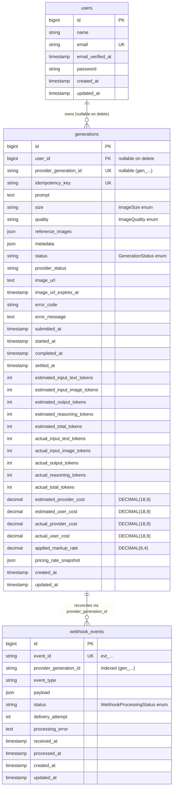

# Database Schema, Models & Data Integrity

NextPixel uses PostgreSQL with a schema designed for financial accuracy, historical auditability, and asynchronous event processing.

---

## Entity Relationship Diagram



---

## Table Specifications

### 1. `generations` Table

Migration: [`2026_11_24_041001_create_generations_table.php`](file:///home/abdelrahman/me/next-pixel/database/migrations/2026_11_24_041001_create_generations_table.php)

| Column                    | Type            | Nullable | Description                                                      |
| :------------------------ | :-------------- | :------: | :--------------------------------------------------------------- |
| `id`                      | `BIGINT`        |    No    | Internal auto-increment primary key                              |
| `user_id`                 | `BIGINT`        | **Yes**  | Foreign key to `users.id` with `onDelete('set null')`            |
| `provider_generation_id`  | `VARCHAR(255)`  | **Yes**  | Unique Pixelforge generation ID (`gen_...`). Nullable initially. |
| `idempotency_key`         | `VARCHAR(255)`  |    No    | Unique client-generated UUID to prevent duplicate requests       |
| `prompt`                  | `TEXT`          |    No    | Prompt text (up to 4,000 characters)                             |
| `size`                    | `VARCHAR(50)`   |    No    | Resolution: `1024x1024`, `1536x1024`, `1024x1536`                |
| `quality`                 | `VARCHAR(20)`   |    No    | Quality tier: `low`, `medium`, `high`                            |
| `reference_images`        | `JSON`          |   Yes    | Array of reference image URLs (up to 4)                          |
| `metadata`                | `JSON`          |   Yes    | Arbitrary custom metadata key-values                             |
| `status`                  | `VARCHAR(30)`   |    No    | `queued`, `processing`, `succeeded`, `failed`                    |
| `image_url`               | `TEXT`          |   Yes    | Final generated image URL                                        |
| `image_url_expires_at`    | `TIMESTAMP`     |   Yes    | Temporary signed URL expiration timestamp                        |
| `submitted_at`            | `TIMESTAMP`     |   Yes    | Time request was submitted to provider                           |
| `started_at`              | `TIMESTAMP`     |   Yes    | Time provider started processing                                 |
| `completed_at`            | `TIMESTAMP`     |   Yes    | Time provider finished processing                                |
| `settled_at`              | `TIMESTAMP`     |   Yes    | Time financial settlement occurred                               |
| `estimated_*_tokens`      | `INTEGER`       |   Yes    | Token estimates per category and total                           |
| `actual_*_tokens`         | `INTEGER`       |   Yes    | Final actual token usage reported by provider                    |
| `estimated_provider_cost` | `DECIMAL(18,9)` |   Yes    | Upstream cost estimate                                           |
| `estimated_user_cost`     | `DECIMAL(18,9)` |   Yes    | Customer price estimate (Provider × 1.25)                        |
| `actual_provider_cost`    | `DECIMAL(18,9)` |   Yes    | Actual expense charged by Pixelforge                             |
| `actual_user_cost`        | `DECIMAL(18,9)` |   Yes    | Final customer charge                                            |
| `applied_markup_rate`     | `DECIMAL(6,4)`  |    No    | Applied markup rate (default `0.2500` / 25%)                     |
| `pricing_rate_snapshot`   | `JSON`          |   Yes    | Snapshot of provider rates active at estimation time             |

---

### 2. `webhook_events` Table

Migration: [`2026_11_24_041002_create_webhook_events_table.php`](file:///home/abdelrahman/me/next-pixel/database/migrations/2026_11_24_041002_create_webhook_events_table.php)

Designed to support reliable, idempotent webhook ingestion:

- **`event_id`**: Guaranteed unique provider event ID (`evt_...`). Enforces idempotency at the database level against duplicate deliveries.
- **`provider_generation_id`**: Indexed nullable reference (`gen_...`). Allows events to be recorded even before the generation record exists locally.
- **`status`**: State machine (`pending`, `processed`, `failed`, `ignored`).
- **`payload`**: Full raw JSON payload preserved for audit and replay capability.

---

## Domain Enums

Enums are backed by string values and provide domain validation:

- [`GenerationStatus`](file:///home/abdelrahman/me/next-pixel/app/Enums/GenerationStatus.php):
    - `Queued = 'queued'`
    - `Processing = 'processing'`
    - `Succeeded = 'succeeded'`
    - `Failed = 'failed'`
    - Helper: `$status->isTerminal()` returns `true` for `succeeded` and `failed`.
- [`WebhookProcessingStatus`](file:///home/abdelrahman/me/next-pixel/app/Enums/WebhookProcessingStatus.php):
    - `Pending = 'pending'`
    - `Processed = 'processed'`
    - `Failed = 'failed'`
    - `Ignored = 'ignored'`
- [`ImageSize`](file:///home/abdelrahman/me/next-pixel/app/Enums/ImageSize.php):
    - `Square = '1024x1024'`
    - `Landscape = '1536x1024'`
    - `Portrait = '1024x1536'`
- [`ImageQuality`](file:///home/abdelrahman/me/next-pixel/app/Enums/ImageQuality.php):
    - `Low = 'low'`
    - `Medium = 'medium'`
    - `High = 'high'`

---

## Data Integrity Rules

### 1. Preserving Unknown vs. Zero Costs

- **Pending/In-Flight Costs:** `actual_provider_cost` and `actual_user_cost` remain `NULL`. They are unknown until generation completes.
- **Failed Generations:** Explicitly set to `'0.000000000'` for `actual_user_cost` to signify that the customer is not billed for a failed generation, distinguishing it from an unsettled state.

### 2. Account Deletion & Audit Integrity (`nullOnDelete`)

When a user deletes their account:

- The foreign key constraint executes `SET NULL` on `generations.user_id`.
- The generation record, token consumption, provider expenditure, and financial audit logs are **preserved**.
- This satisfies financial compliance, reconciliation with Pixelforge invoices, and company expense reporting.

### 3. Arbitrary Decimal Model Casting

In the [`Generation`](file:///home/abdelrahman/me/next-pixel/app/Models/Generation.php) model:

```php
protected function casts(): array
{
    return [
        'status' => GenerationStatus::class,
        'size' => ImageSize::class,
        'quality' => ImageQuality::class,
        'reference_images' => 'array',
        'metadata' => 'array',
        'pricing_rate_snapshot' => 'array',
        'estimated_provider_cost' => 'decimal:9',
        'estimated_user_cost' => 'decimal:9',
        'actual_provider_cost' => 'decimal:9',
        'actual_user_cost' => 'decimal:9',
        'applied_markup_rate' => 'decimal:4',
        'submitted_at' => 'datetime',
        'started_at' => 'datetime',
        'completed_at' => 'datetime',
        'settled_at' => 'datetime',
    ];
}
```

Laravel's `decimal:9` cast formats values through `BigDecimal` to ensure trailing zeroes are preserved and no precision is lost when querying PostgreSQL.

---

## Automated Tests

Run the model and schema test suites:

```bash
php artisan test --filter=GenerationTest
php artisan test --filter=WebhookEventTest
```
